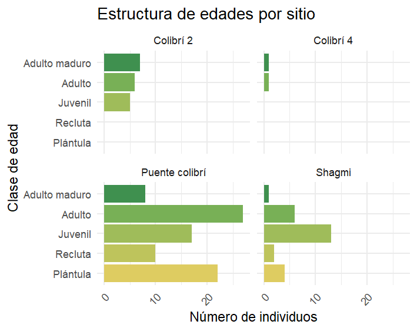

## Ecología de Poblaciones y Comunidades

**Clase 1.1 — Propiedades de las poblaciones**

Carlos Iván Espinosa
Universidad Técnica Particular de Loja

---

## Objetivos de la clase

Al finalizar esta sesión, podrás:

- **Definir** qué es una población y distinguirla de un simple grupo de individuos
- **Identificar** los cinco atributos emergentes de una población
- **Diferenciar** propiedades primarias de secundarias
- **Aplicar** estos conceptos a poblaciones locales del sur de Ecuador

---

# Parte 1: ¿Qué es una población?

## Definición

> Una **población** es un conjunto de individuos de la **misma especie** que ocupan un **mismo espacio** en un **mismo tiempo** y que tienen **potencial de reproducirse entre sí**.

::: {.fragment}
Los cuatro criterios parecen simples, pero cada uno esconde problemas.
:::

---

## Criterio 1: Misma especie

**¿Qué define a una especie?**

- Individuos que pueden reproducirse entre sí y dejar descendencia fértil
- Pero la frontera no siempre es nítida

**Ejemplo local:**

- *Tremarctos ornatus* (oso de anteojos) — claramente una especie
- ¿Qué pasa con morfos de aves que hibridan en zonas de contacto?

::: {.notes}
Preguntar a los estudiantes: ¿conocen casos de especies que hibridan?
Ejemplo andino: algunos colibríes del género *Coeligena*.
:::

---

## Criterio 2: Mismo espacio

**¿Qué significa "mismo espacio"?**

- ¿Un fragmento de bosque?
- ¿Una cuenca?
- ¿La hoya de Loja entera?

::: {.fragment}
El espacio lo define la especie, no el investigador.
:::

**Ejemplo:** Una población de *Cedrela montana* puede abarcar varios fragmentos si hay flujo de polen. Una población de osos necesita cientos de km².

---

## Criterio 3: Mismo tiempo

Las poblaciones **cambian en el tiempo**.

Una población de *Cedrela montana* que existía en la hoya de Loja hace 100 años **no es la misma** que la de hoy:

- Algunos individuos murieron
- Otros nacieron
- Hubo inmigración y emigración

**Pregunta:** ¿Cuánto tiempo de coexistencia se necesita para hablar de "la misma población"?

---

## Criterio 4: Potencial reproductivo

**El criterio más importante.**

Dos grupos de individuos pueden estar en el mismo espacio y tiempo, pero si **no pueden reproducirse entre ellos** (barreras geográficas, conductuales o genéticas), no forman una población.

::: {.fragment}
Lo que define a una población no es solo la coexistencia, sino la **conexión reproductiva**.
:::

---

## Síntesis: los 4 criterios

| Criterio | Pregunta clave |
|---|---|
| Misma especie | ¿Pueden reproducirse y dejar descendencia fértil? |
| Mismo espacio | ¿Comparten un área donde interactúan? |
| Mismo tiempo | ¿Coexisten en el mismo período? |
| Potencial reproductivo | ¿Hay conexión reproductiva real? |

---

# Parte 2: El problema de la delimitación

## Caso de estudio: *Cedrela montana* en la hoya de Loja

**Escenario:**

- Fragmento 1: La Argelia
- Fragmento 2: Cerro Villonaco
- Fragmento 3: San José-El Cisne

Entre los fragmentos hay: áreas deforestadas, potreros, carreteras.

> **¿Son una población o tres?**

---

## Factores que determinan la respuesta

1. **Flujo génico** — ¿hay polen o semillas que viajan entre fragmentos?
2. **Tamaño de los fragmentos** — ¿pueden sostener poblaciones viables?
3. **Historia de la fragmentación** — ¿reciente o antigua?
4. **Pregunta de investigación** — ¿qué me interesa estudiar?

::: {.fragment}
La delimitación de una población es una **decisión analítica**, no un hecho natural.
:::

---

## Actividad en grupos (15 min)

Dividirse en tres grupos. Cada grupo analiza el caso y responde:

**Grupo 1:** ¿Qué información necesitarían para decidir si son una o tres poblaciones?

**Grupo 2:** ¿Cómo obtendrían esa información en el campo?

**Grupo 3:** Si tuvieran que decidir con información incompleta, ¿qué criterio usarían?

**Puesta en común:** 3 min por grupo.

---

# Parte 3: Individuo vs. población

## Dos niveles de organización

| Propiedad | Individuo | Población |
|---|---|---|
| Edad | Edad cronológica | Estructura etaria |
| Sexo | Macho/hembra | Sex ratio |
| Tamaño | Peso, talla | Densidad |
| Nacimiento/muerte | Eventos únicos | Tasas poblacionales |
| Persistencia | Muere | Puede persistir siglos |

::: {.fragment}
Las propiedades poblacionales **no se reducen** a la suma de las propiedades individuales.
:::

---

## Implicaciones

Si un oso muere en el Podocarpus:

- El **individuo** desaparece
- La **población** no muere: tiene una **tasa de mortalidad**

::: {.fragment}
Una población puede:

- **Crecer** aunque muchos individuos mueran (si la natalidad compensa)
- **Decrecer** aunque todos estén sanos (si no se reproducen)
:::

---

## Pregunta para discutir

> Si en una población de *Tremarctos ornatus* mueren 2 individuos al año pero nacen 3, **¿la población crece o decrece?**

::: {.fragment}
**Variantes:**

- Mueren 3, nacen 2
- Mueren 3, nacen 2, pero llegan 2 de otra población
:::

::: {.notes}
Discutir 5 min. Guiar hacia el balance entre natalidad, mortalidad, inmigración y emigración.
:::

---

# Parte 4: Atributos emergentes

## Los cinco atributos

Propiedades que **solo existen al nivel poblacional**:

1. **Abundancia**
2. **Densidad**
3. **Distribución espacial**
4. **Estructura etaria**
5. **Sex ratio**

Los vemos uno por uno.

---

## Atributo 1: Abundancia

**Definición:** número total de individuos de una población en un área determinada.

**Dos formas:**

- **Abundancia absoluta:** número total estimado
- **Abundancia relativa:** índice que compara poblaciones o condiciones

**Ejemplo local:**

- 80 individuos de *Cedrela montana* en 20 parcelas de 1 ha
- Densidad media: 4 ind/ha
- Si el bosque apto son 500 ha → abundancia absoluta ≈ 2.000 individuos

**Problema práctico:** no podemos censar; solo estimar a partir de muestras.

---

## Atributo 2: Densidad

**Definición:** número de individuos por unidad de área.

```{r, echo=FALSE, fig.align='center', out.width='90%', fig.height=4.2}
library(ggplot2)
library(patchwork)

osos1 <- data.frame(x = runif(100, 0, 100), y = runif(100, 0, 100))
osos2 <- data.frame(x = runif(100, 0, 100), y = runif(100, 0, 100))

p1 <- ggplot(osos1, aes(x, y)) +
  geom_point(size = 1.5, color = "#2e7d32", alpha = 0.7) +
  labs(title = "100 osos en 1.000 km²",
       subtitle = "Densidad = 0,1 ind/km²",
       x = "", y = "") +
  theme_minimal(base_size = 12) +
  coord_fixed() +
  theme(axis.text = element_blank(),
        panel.grid = element_blank(),
        plot.title = element_text(face = "bold"),
        plot.subtitle = element_text(color = "#e53935"))

p2 <- ggplot(osos2, aes(x, y)) +
  geom_point(size = 1.5, color = "#2e7d32", alpha = 0.7) +
  labs(title = "100 osos en 100 km²",
       subtitle = "Densidad = 1 ind/km²",
       x = "", y = "") +
  theme_minimal(base_size = 12) +
  coord_fixed() +
  theme(axis.text = element_blank(),
        panel.grid = element_blank(),
        plot.title = element_text(face = "bold"),
        plot.subtitle = element_text(color = "#e53935"))

p1 + p2
```

::: {.fragment}
Misma abundancia, densidad 10 veces mayor.
:::

---

## Atributo 3: Distribución espacial

**Tres patrones básicos:**

```{r, echo=FALSE, fig.align='center', out.width='95%', fig.height=4}
library(ggplot2)
library(patchwork)

set.seed(123)

agregada <- data.frame(
  x = c(rnorm(80, 0.3, 0.1), rnorm(20, 0.7, 0.05)),
  y = c(rnorm(80, 0.3, 0.1), rnorm(20, 0.7, 0.05))
)

aleatoria <- data.frame(x = runif(100), y = runif(100))

uniforme <- expand.grid(x = seq(0.1, 0.9, length.out = 10),
                        y = seq(0.1, 0.9, length.out = 10))

p1 <- ggplot(agregada, aes(x, y)) +
  geom_point(size = 2, color = "#2e7d32") +
  labs(title = "Agregada", x = "", y = "") +
  theme_minimal(base_size = 12) +
  coord_fixed() +
  theme(axis.text = element_blank(),
        panel.grid = element_blank(),
        plot.title = element_text(hjust = 0.5, face = "bold"))

p2 <- ggplot(aleatoria, aes(x, y)) +
  geom_point(size = 2, color = "#2e7d32") +
  labs(title = "Aleatoria", x = "", y = "") +
  theme_minimal(base_size = 12) +
  coord_fixed() +
  theme(axis.text = element_blank(),
        panel.grid = element_blank(),
        plot.title = element_text(hjust = 0.5, face = "bold"))

p3 <- ggplot(uniforme, aes(x, y)) +
  geom_point(size = 2, color = "#2e7d32") +
  labs(title = "Uniforme", x = "", y = "") +
  theme_minimal(base_size = 12) +
  coord_fixed() +
  theme(axis.text = element_blank(),
        panel.grid = element_blank(),
        plot.title = element_text(hjust = 0.5, face = "bold"))

p1 + p2 + p3
```

**Causas:** competencia, territorialidad, dispersión limitada, heterogeneidad ambiental.

---

## Atributo 4: Estructura etaria

**Se representa con pirámides poblacionales:**

```{r, echo=FALSE, fig.align='center', out.width='95%', fig.height=4.8}
library(ggplot2)

edades <- c("0-10", "11-20", "21-30", "31-40", "41-50", "51+")

crecimiento <- data.frame(
  edad = factor(edades, levels = edades),
  valor = c(40, 30, 20, 12, 6, 3),
  tipo = "Crecimiento"
)

estable <- data.frame(
  edad = factor(edades, levels = edades),
  valor = c(20, 20, 20, 20, 20, 20),
  tipo = "Estable"
)

declive <- data.frame(
  edad = factor(edades, levels = edades),
  valor = c(5, 8, 12, 18, 25, 35),
  tipo = "Declive"
)

datos <- rbind(crecimiento, estable, declive)

ggplot(datos, aes(x = edad, y = valor, fill = tipo)) +
  geom_col(show.legend = FALSE) +
  coord_flip() +
  facet_wrap(~tipo, ncol = 3) +
  scale_fill_manual(values = c("Crecimiento" = "#43a047",
                                "Estable" = "#fbc02d",
                                "Declive" = "#e53935")) +
  labs(x = "Clase de edad", y = "Proporción de individuos") +
  theme_minimal(base_size = 13) +
  theme(
    strip.text = element_text(face = "bold", size = 14),
    panel.grid.minor = element_blank()
  )
```

- **Base ancha** → crecimiento
- **Forma de campana** → estabilidad
- **Base estrecha** → declive

---

## Estructura etaria: ejemplos locales

:::: {.two-cols}

::: {}
**Caso 1 — *Tremarctos ornatus* en Podocarpus**

Si encontramos pocos juveniles:

- Los adultos sobreviven
- **Pero no hay reemplazo generacional**

→ Problema de **reclutamiento**
:::

::: {}
**Caso 2 — *Cedrela montana* en hoya de Loja**

Si encontramos muchos adultos y ninguna plántula:

- Los árboles están presentes
- **Pero no se regeneran**

→ **Regeneración fallida**
:::

::::

::: {.fragment}
La estructura etaria es una **predicción del futuro**, no solo un reflejo del pasado.
:::

---

## Estructura de *Magnolia yantyazana*

:::: {.columns}

::: {.column width="57%"}

{width=100% fig-align="center"}
::: 

::: {.column width="30%"}
\
\

::: {.fragment}

> **¿Que podemos decir de estas poblaciones?**

:::
:::
::::
---

## Atributo 5: Sex ratio

**Definición:** proporción de machos y hembras.

```{r, echo=FALSE, fig.align='center', out.width='90%', fig.height=4}
library(ggplot2)

sr1 <- data.frame(
  sexo = c("Hembras", "Machos"),
  n = c(50, 50),
  escenario = "Sex ratio 1:1"
)

sr2 <- data.frame(
  sexo = c("Hembras", "Machos"),
  n = c(25, 75),
  escenario = "3 machos : 1 hembra"
)

sr3 <- data.frame(
  sexo = c("Hembras", "Machos"),
  n = c(75, 25),
  escenario = "3 hembras : 1 macho"
)

datos <- rbind(sr1, sr2, sr3)

ggplot(datos, aes(x = sexo, y = n, fill = sexo)) +
  geom_col(show.legend = FALSE) +
  geom_text(aes(label = n), vjust = -0.5, size = 4) +
  facet_wrap(~escenario, ncol = 3) +
  scale_fill_manual(values = c("Hembras" = "#e91e63",
                                "Machos" = "#1976d2")) +
  labs(x = "", y = "Individuos") +
  ylim(0, 100) +
  theme_minimal(base_size = 13) +
  theme(
    strip.text = element_text(face = "bold", size = 13),
    panel.grid.minor = element_blank()
  )
```

**Sex ratio efectiva:** la de individuos que realmente se reproducen (más importante que la total).

---

## Preguntas para discutir
\
\

**Sobre abundancia:**

> En dos fragmentos de bosque encuentras 50 y 100 individuos de *Cedrela montana*. ¿Puedes concluir que el segundo es más abundante? ¿Qué información adicional necesitas?

---

## Preguntas para discutir
\
\

**Sobre distribución espacial:**

> ¿Qué tipo de distribución esperarías en un árbol cuyas semillas caen al pie del parental? ¿Y en un ave territorial?

---

## Preguntas para discutir
\
\

**Sobre estructura etaria:**

> Si una población de cedros tiene muchos adultos y ningún juvenil, ¿qué pasará en 50 años?

::: {.notes}
Dedicar 15 min a estas tres preguntas. Alternar entre discusión y síntesis teórica.
:::

---

# Parte 5: Propiedades primarias vs. secundarias

## Diagrama: procesos y estados

```{r, echo=FALSE, fig.align='center', out.width='95%', fig.height=5}
library(DiagrammeR)

grViz("
digraph primarias_secundarias {

  graph [layout = dot, rankdir = LR, bgcolor = 'transparent']

  node [shape = box, style = 'filled,rounded',
        fontname = 'Helvetica', fontsize = 14,
        color = '#2e7d32', penwidth = 2]

  # Procesos primarios (izquierda)
  N [label = 'Nacimiento', fillcolor = '#c8e6c9']
  M [label = 'Muerte', fillcolor = '#c8e6c9']
  I [label = 'Inmigración', fillcolor = '#c8e6c9']
  E [label = 'Emigración', fillcolor = '#c8e6c9']

  # Estados secundarios (derecha)
  A [label = 'Abundancia', fillcolor = '#a5d6a7']
  D [label = 'Densidad', fillcolor = '#a5d6a7']
  EE [label = 'Estructura\\netaria', fillcolor = '#a5d6a7']
  DE [label = 'Distribución\\nespacial', fillcolor = '#a5d6a7']
  SR [label = 'Sex ratio', fillcolor = '#a5d6a7']

  # Flechas de procesos a estados
  N -> A [color = '#2e7d32', penwidth = 1.5]
  M -> A [color = '#2e7d32', penwidth = 1.5]
  I -> A [color = '#2e7d32', penwidth = 1.5]
  E -> A [color = '#2e7d32', penwidth = 1.5]

  N -> EE [color = '#2e7d32', penwidth = 1.5, style = dashed]
  M -> EE [color = '#2e7d32', penwidth = 1.5, style = dashed]

  N -> D [color = '#2e7d32', penwidth = 1.5, style = dotted]
  I -> DE [color = '#2e7d32', penwidth = 1.5, style = dotted]
  E -> DE [color = '#2e7d32', penwidth = 1.5, style = dotted]

  N -> SR [color = '#2e7d32', penwidth = 1.5, style = dotted]

  # Etiquetas de grupo
  subgraph cluster_primarias {
    label = 'PROCESOS PRIMARIOS';
    fontname = 'Helvetica-Bold';
    fontsize = 14;
    color = '#1b5e20';
    style = dashed;
    N; M; I; E;
  }

  subgraph cluster_secundarias {
    label = 'ESTADOS SECUNDARIOS';
    fontname = 'Helvetica-Bold';
    fontsize = 14;
    color = '#1b5e20';
    style = dashed;
    A; D; EE; DE; SR;
  }
}
")
```

Las **primarias** son las causas; las **secundarias** son los indicadores.

---

## Implicación para la conservación

**Si queremos conservar una población de cedros:**

- No podemos actuar directamente sobre la **abundancia** (secundaria)
- Tenemos que actuar sobre la **mortalidad** (primaria): reducir la tala

**Si queremos aumentar osos en el Podocarpus:**

- ¿Sobre qué propiedad primaria actuaríamos primero?

::: {.notes}
Discutir 5 min. Guiar hacia: reducir mortalidad, aumentar natalidad, facilitar inmigración.
:::

---

## Las primarias son las que podemos manejar

```{r, echo=FALSE, fig.align='center', out.width='85%', fig.height=4.5}
library(ggplot2)

acciones <- data.frame(
  accion = c("Reducir tala", "Crear corredores",
             "Programas de cría", "Control de depredadores"),
  propiedad = c("Mortalidad", "Inmigración",
                "Natalidad", "Mortalidad"),
  efecto = c(0.8, 0.6, 0.5, 0.7)
)

ggplot(acciones, aes(x = reorder(accion, efecto), y = efecto,
                     fill = propiedad)) +
  geom_col(show.legend = TRUE) +
  coord_flip() +
  scale_fill_manual(values = c("Mortalidad" = "#e53935",
                                "Natalidad" = "#43a047",
                                "Inmigración" = "#1976d2")) +
  labs(x = "", y = "Efecto esperado sobre la población",
       fill = "Propiedad primaria") +
  ylim(0, 1) +
  theme_minimal(base_size = 13) +
  theme(legend.position = "bottom",
        panel.grid.minor = element_blank())
```

---

# Cierre

## Síntesis

- Una población no es un simple conjunto de individuos
- Tiene **cinco atributos emergentes** que no existen al nivel individual
- Los procesos primarios (nacer, morir, migrar) generan los estados secundarios
- **Delimitar una población es una decisión analítica**, no un hecho natural

---

## Pregunta final

> **¿Qué población de Loja te gustaría estudiar y qué propiedad medirías primero?**

Piensen en una especie local (planta, ave, mamífero, insecto) y justifiquen su elección.

::: {.notes}
Recoger respuestas rápidas. Conectar con la Tarea 1.
:::

---

## Puente a la próxima clase

- **Hoy:** qué es una población y cuáles son sus propiedades
- **Próxima semana:** cómo se cuantifican los procesos primarios → **demografía y tablas de vida**
- **Recordatorio:** la Tarea 1 está abierta en Canvas

Gracias.

---

# Materiales del curso

- 📖 [Lectura 1.1 — Propiedades de las poblaciones](https://TU-USUARIO.github.io/curso-ecologia/lecturas/01-poblaciones.html)
- 📝 [Tarea 1 — Abundancia y densidad](https://TU-USUARIO.github.io/curso-ecologia/tareas/01-abundancia-densidad.html)
- 🎮 [Ejercicio 1 — App interactiva](https://ciespinosa.shinyapps.io/trabajo1/)